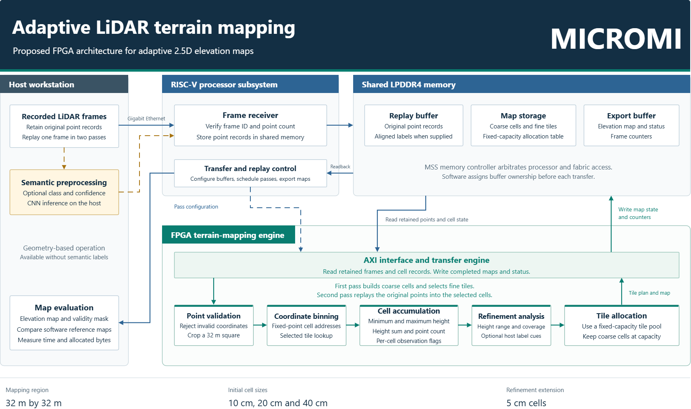

# MICROMI

Adaptive LiDAR terrain mapping using the PolarFire SoC Icicle Kit.

MICROMI explores how an FPGA can turn LiDAR points into a compact terrain map for mobile robots and off-road vehicles. It builds on our earlier work in adaptive 2.5D mapping, where each cell in a top-down grid stores height information.

## The idea

A flat stretch of ground needs less map detail than a curb, slope or uneven surface. Using small cells everywhere wastes memory. Using large cells everywhere can hide useful terrain features.

Our mapper will adjust cell size to the terrain. It will keep a coarse map of the full area and allocate finer cells where height changes need more detail, within a fixed memory budget. Areas without LiDAR measurements will remain unknown.

## How it works

A host computer sends recorded LiDAR points to the board over Ethernet. The RISC-V processor stores the frame and controls the FPGA mapper.

The FPGA first groups points into coarse cells and calculates height statistics. It then selects areas for refinement and reads the original points again to fill the finer cells. The completed map returns to the host for display and comparison with a software reference.

[Open PDF](diagrams/MICROMI-System-Block-Diagram.pdf) | [Editable draw.io source](diagrams/MICROMI-System-Block-Diagram.drawio) | [SVG](diagrams/MICROMI-System-Block-Diagram.svg)

## Why FPGA?

LiDAR mapping repeats the same operations for many points: checking coordinates, finding cell addresses and updating height statistics. A hardware pipeline can overlap these stages, processing different points at different stages at the same time.

Moving this work into the FPGA leaves the RISC-V processor to handle communication and control. Custom integer arithmetic also lets us choose data widths for the map's coordinate range and memory budget. Shared-memory traffic and repeated updates to the same cell will still affect throughput.

The [PolarFire SoC Icicle Kit](https://www.microchip.com/en-us/development-tool/mpfs-icicle-kit) combines RISC-V processors, FPGA fabric, LPDDR4 memory and Gigabit Ethernet on one board. This makes it suitable for testing the complete data path.

## First prototype

We will start with single-frame maps covering a 32 m square area, using 10, 20 and 40 cm cells. The target is one million input points per second. Evaluation will compare terrain detail, memory use and complete processing time against software and fixed-resolution maps.

The architecture is defined; FPGA implementation and hardware measurements are the next stage. Speed and power benefits remain to be measured.
